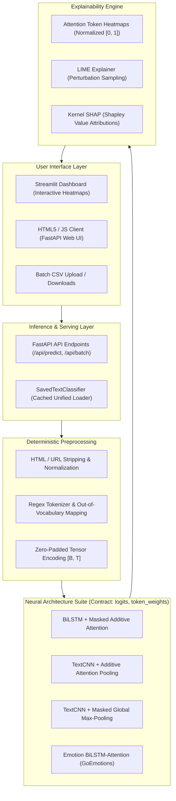

# SentixAI: Explainable Deep Learning System for Sentiment & Emotion Analysis

<div align="center">

[](https://www.python.org/)
[](https://pytorch.org/)
[](https://fastapi.tiangolo.com/)
[](https://streamlit.io/)
[](LICENSE)

**An end-to-end, reproducible Explainable AI (XAI) platform featuring multi-architecture deep learning (BiLSTM + Attention, TextCNN with Attention and Max Pooling), model transparency (Additive Attention, LIME, Kernel SHAP), and dual deployment interfaces (FastAPI & Streamlit).**

[Live Web Demo](https://senxtixai.streamlit.app/) • [Quickstart](#-quickstart) • [Model Architectures](#-model-architectures) • [Empirical Benchmark](#-empirical-benchmark-results) • [API Reference](#-api-endpoints) • [Deployment](#-cloud-deployment-guide)

</div>

---

## 📌 Overview

Modern Natural Language Processing models frequently suffer from "black-box" opacity—producing high-confidence classifications without exposing the semantic rationale driving their decisions. **SentixAI** bridges the gap between deep sequence modeling and explainability.

Designed for robust production deployment and rigorous research benchmarking, SentixAI features:
1. **Multi-Architecture Sentiment Suite:** Choose dynamically between **Bidirectional LSTM with Additive Attention** and **TextCNN** (supporting parameterized **Additive Attention Pooling** or **Masked Global Max-Pooling**).
2. **Fine-Grained Emotion Recognition:** An independent multi-class classifier trained on curated GoEmotions data identifying `joy`, `sadness`, `anger`, `fear`, `surprise`, `love`, and `disappointment`.
3. **Tri-Method Explainable AI (XAI):**
   - **Intrinsic Attention Weights:** Real-time token attribution extracted directly from model attention layers or channel-argmax max-pool distributions.
   - **LIME (Local Interpretable Model-agnostic Explanations):** Feature perturbation to measure localized word importance.
   - **Kernel SHAP (Shapley Additive exPlanations):** Game-theoretic feature attributions relative to baseline sequences.
4. **Controlled Multi-Seed Benchmark Suite:** Automated training, hyperparameter sweeps, and 3-seed statistical reporting on the 50,000-review Stanford IMDB dataset.
5. **Dual Serving Interfaces:** Production-grade **FastAPI** REST backend and responsive **Streamlit** dashboard with interactive token heatmaps and bulk CSV batch processing.

---

## 🏗️ System Architecture



---

## 🧠 Model Architectures

All models strictly conform to the unified forward contract:
$$\text{forward}(\text{token\_ids}_{[B, T]}) \longrightarrow \left(\text{logits}_{[B, C]},\ \text{token\_weights}_{[B, T]}\right)$$
where $\sum_{t} \text{token\_weights}_{b, t} \approx 1$ over non-padding tokens.

### 1. Bidirectional LSTM + Additive Attention (`bilstm_attention`)
```text
Tokens [B, T] ──► Embedding [B, T, D] ──► BiLSTM [B, T, 2H] ──► Additive Attention ──► Context [B, 2H] ──► Dropout ──► Linear [B, C]
                                                                        │
                                                                        └──► Token Weights [B, T]
```
- **Forward & Backward Context:** Reads input token sequences bidirectionally, capturing long-range contextual dependencies.
- **Additive Attention:** A learnable MLP scoring function computes dynamic token relevance:
  $$e_t = \mathbf{v}^\top \tanh(\mathbf{W} h_t + \mathbf{b}), \quad \alpha_t = \frac{\exp(e_t)}{\sum_{k} \exp(e_k)}$$
  The weighted sum $\mathbf{c} = \sum_t \alpha_t h_t$ forms the sequence representation.

---

### 2. TextCNN with Dual Pooling Modes (`textcnn`, `textcnn_max`)
```text
Tokens [B, T] ──► Embedding [B, T, D] ──► Parallel Conv1D (k=3, 4, 5) ──► Concat [B, 3F, T]
                                                                                │
                                           ┌────────────────────────────────────┴────────────────────────────────────┐
                                           ▼                                                                         ▼
                         [Mode: Attention Pooling]                                                 [Mode: Global Max Pooling]
                         Additive Attention over Concat Features                                   Masked Max-Pool across Time
                         ├── Context Vector: [B, 3F]                                               ├── Context Vector: [B, 3F]
                         └── Token Weights: Attention Distribution [B, T]                          └── Token Weights: Channel Argmax Share [B, T]
                                           │                                                                         │
                                           └────────────────────────────────────┬────────────────────────────────────┘
                                                                                ▼
                                                              Dropout ──► Linear Classifier [B, C]
```
- **Feature Extraction:** Parallel 1D convolutions with length-preserving `padding="same"` extract multi-scale $n$-gram representations ($k \in \{3, 4, 5\}$).
- **Attention Pooling (`textcnn`):** Applies additive attention across feature maps, assigning importance based on local convolutional features.
- **Max-Pooling (`textcnn_max`):** Performs temporal max-pooling with a novel **Channel Argmax Share** attribution, where each token's weight corresponds to the fraction of convolutional channels whose maximum response was triggered by that specific token.

---

## 📊 Empirical Benchmark Results

We conducted a controlled empirical architecture study on the full **Stanford IMDB Dataset** (49,582 reviews after deduplication; Train: 39,665, Validation: 4,958, Test: 4,959) using a fixed vocabulary (20,000 tokens) and sequence length (200 tokens) evaluated across **3 random seeds (`[42, 43, 44]`)**.

Best architectures were selected strictly by **Validation Macro-F1**, reporting separate held-out test metrics:

| Model Architecture | Pooling / Mechanism | Val Macro-F1 (Mean ± Std) | Test Macro-F1 (Mean ± Std) | Test Accuracy (Mean ± Std) | Mean Train Time | Parameters |
|:---|:---:|:---:|:---:|:---:|:---:|:---:|
| **BiLSTM + Attention** *(Best Overall)* | Additive Attention | **0.8795 ± 0.0044** | **0.8810 ± 0.0030** | **88.11% ± 0.31%** | 103.4s | 3,356,802 |
| **BiLSTM Baseline** | Last Hidden State | 0.8773 ± 0.0035 | 0.8805 ± 0.0066 | 88.06% ± 0.67% | 109.2s | 3,356,546 |
| **TextCNN** | **Attention Pooling** | **0.8723 ± 0.0012** | **0.8735 ± 0.0055** | **87.37% ± 0.56%** | **87.1s** | 2,807,170 |
| **MLP Baseline** | Mean Embedding Pool | 0.8701 ± 0.0058 | 0.8734 ± 0.0076 | 87.34% ± 0.75% | **31.8s** | 2,576,642 |
| **TextCNN (Filters=64, LR=0.0005)** | Attention Pooling | 0.8527 ± 0.0036 | 0.8554 ± 0.0080 | 85.56% ± 0.81% | 83.2s | 2,683,970 |
| **TextCNN** | **Global Max-Pooling** | 0.8448 ± 0.0081 | 0.8478 ± 0.0106 | 84.82% ± 1.02% | 88.3s | 2,757,634 |
| **LSTM Baseline** | Unidirectional Last | 0.8133 ± 0.0398 | 0.8161 ± 0.0372 | 81.66% ± 3.75% | 70.2s | 2,831,490 |

### Key Findings
1. **Competitive CNN Accuracy:** `TextCNN` with Attention Pooling achieved **87.37% test accuracy** (within $\sim 0.7\%$ of the BiLSTM-Attention model) while training **16% faster**.
2. **Attention vs. Max Pooling:** Attention pooling outperformed Global Max-Pooling on TextCNN by **+2.55% test accuracy**, proving the value of soft attention over hard pooling for document sentiment.
3. **Dual Checkpoints Preserved:** Production checkpoints (`bilstm_attention.pt` at 90.02% and `emotion_bilstm_attention.pt` at 73.44%) remain untouched and fully loadable via backward-compatible loaders.

---

## ⚡ Quickstart

### 1. Clone & Set Up Environment
```bash
git clone https://github.com/SoumyadeepXD/SentixAIsharable.git
cd SentixAIsharable

# Create virtual environment
python3 -m venv .venv
source .venv/bin/activate

# Install dependencies
pip install --upgrade pip
pip install -r requirements.txt
```

### 2. Run the Web Applications

#### Option A: Streamlit Interactive Platform (Recommended)
```bash
streamlit run streamlit_app.py
```
> Opens at `http://localhost:8501`. Features sidebar architecture switching (`BiLSTM`, `TextCNN Attention`, `TextCNN Max Pool`), live token heatmaps, LIME, and SHAP.

#### Option B: FastAPI Backend & Classic Dashboard
```bash
uvicorn app:app --reload --port 8000
```
> Opens at `http://localhost:8000`. Swagger API docs available at `http://localhost:8000/docs`.

---

## 💻 CLI Commands & Reproducibility

### 1. Interactive Model Predictions
```bash
# Predict with production BiLSTM + Attention
python predict_sentixai.py --text "An absolute triumph of modern cinema, breathtakingly poignant."

# Predict with TextCNN (Attention Pooling)
python predict_sentixai.py --model-name textcnn.pt --text "An absolute triumph of modern cinema, breathtakingly poignant."

# Joint Sentiment + Emotion Prediction
python predict_sentixai_full.py --text "The visual effects were astonishing, but the narrative felt disjointed."
```

### 2. Explainable AI Inspections (Attention, LIME, SHAP)
```bash
python explain_sentixai.py \
  --text "The cinematography was gorgeous, but the terrible script ruined the entire movie." \
  --model sentiment \
  --model-name textcnn.pt \
  --methods attention lime shap
```

### 3. Model Training
```bash
# Train TextCNN with Attention Pooling
python train_sentixai.py --csv "data/IMDB Dataset.csv" --model-type textcnn --epochs 10

# Train TextCNN with Global Max Pooling
python train_sentixai.py --csv "data/IMDB Dataset.csv" --model-type textcnn_max --epochs 10

# Train BiLSTM with Attention
python train_sentixai.py --csv "data/IMDB Dataset.csv" --model-type bilstm_attention --epochs 10
```

### 4. Controlled Benchmark Suite Execution
```bash
# Execute multi-seed comparative benchmark across all architectures
python run_experiments.py --config experiment_config.json --csv "data/IMDB Dataset.csv"
```

---

## 🧪 Automated Testing Suite

The repository includes a comprehensive test suite covering model shapes, weight distributions, edge cases, and inference regression:

```bash
# Run unit & architectural regression tests
python tests/test_models_and_sanity.py

# Run diverse 12-sample evaluation suite across all architectures
python tests/test_10_samples.py
```

- **Shape & Weight Sum Tests:** Verifies token weights sum to $\sim 1.0$ over non-pad tokens and are $\sim 0.0$ on padding.
- **Edge Cases:** Guarantees no `NaN` outputs on all-padding sequences and zero crashes on inputs shorter than the maximum convolution kernel ($T < 5$).
- **Backward Compatibility:** Validates that legacy `bilstm_attention.pt` checkpoints load transparently and produce exact predictions.

---

## 🌐 Cloud Deployment Guide

### Option 1: Streamlit Community Cloud (Free & Permanent)
1. Push your repository to GitHub (`https://github.com/SoumyadeepXD/SentixAIsharable`).
2. Log into [share.streamlit.io](https://share.streamlit.io/) with your GitHub account.
3. Click **"New App"** and select:
   - **Repository:** `SoumyadeepXD/SentixAIsharable`
   - **Branch:** `main` (or `feat/textcnn-architecture`)
   - **Main file path:** `streamlit_app.py`
4. Click **Deploy!** Your app will be live at `https://<your-subdomain>.streamlit.app`.

### Option 2: Hugging Face Spaces (Streamlit / Docker)
1. Navigate to [huggingface.co/spaces](https://huggingface.co/spaces) and select **"Create new Space"**.
2. Select **Streamlit** (or **Docker** to use the bundled [`Dockerfile`](Dockerfile)).
3. Link your GitHub repository. Your space will build and launch automatically.

---

## 🔌 API Endpoints

The FastAPI server provides clean, typed REST endpoints:

| Endpoint | Method | Description | Request Body / Params |
|:---|:---:|:---|:---|
| `/health` | `GET` | System health & loaded model statuses | None |
| `/api/models` | `GET` | List available sentiment & emotion models | None |
| `/api/predict` | `POST` | Single-text sentiment + emotion prediction & XAI | `{"text": "...", "model_name": "textcnn.pt", "methods": ["attention", "lime"]}` |
| `/api/batch` | `POST` | Bulk review classification via CSV upload | Form-data file (`.csv`) with `review` column; optional `?model_name=textcnn.pt` |
| `/api/batch/{id}/download` | `GET` | Export processed batch CSV with predictions & confidences | Path param `id` |
| `/api/analytics` | `GET` | Metrics, confusion matrices, and training curves | None |

---

## 📁 Repository Structure

```text
├── app.py                      # FastAPI server & REST API routes
├── streamlit_app.py            # Interactive Streamlit XAI Dashboard
├── sentixai_model.py           # PyTorch architectures (BiLSTM, TextCNN, AdditiveAttention)
├── sentixai_inference.py       # Unified, cached model inference engine
├── sentixai_xai.py             # Attention, LIME, and Kernel SHAP explainers
├── sentixai_data.py            # Tokenization, vocab construction, and datasets
├── train_sentixai.py           # Configurable model training pipeline
├── run_experiments.py          # Multi-seed controlled benchmark runner
├── comparison_models.py        # Baseline & comparative model architectures
├── experiment_config.json      # Experiment hyperparameters and seed configurations
├── predict_sentixai.py         # Standalone CLI sentiment predictor
├── predict_sentixai_full.py    # Joint sentiment + emotion CLI predictor
├── explain_sentixai.py         # Standalone CLI explainability tool
├── tests/
│   ├── test_models_and_sanity.py  # 6-part automated regression test suite
│   └── test_10_samples.py         # 12-sample evaluation benchmark
├── outputs/
│   ├── artifacts/              # Production model weights (.pt) and vocabularies
│   └── experiments/            # Benchmark CSVs, summary tables, and charts
├── static/                     # HTML, CSS, JavaScript assets for FastAPI UI
├── Dockerfile                  # Containerization for cloud deployment
├── requirements.txt            # Python dependencies
└── README.md                   # Project documentation
```

---

## 📜 License

This project is licensed under the **MIT License** — see the [LICENSE](LICENSE) file for details.
